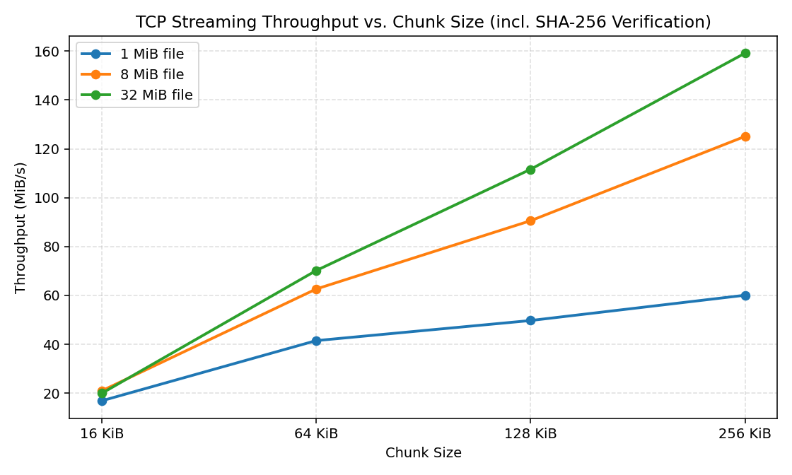
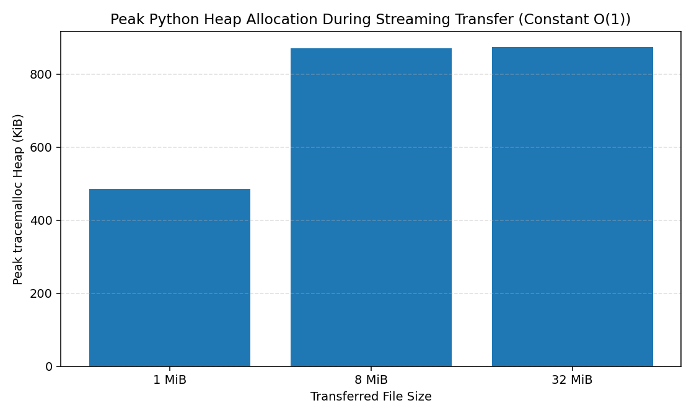
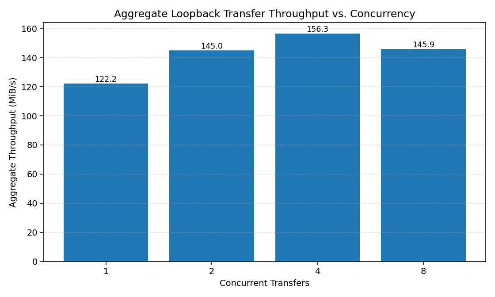
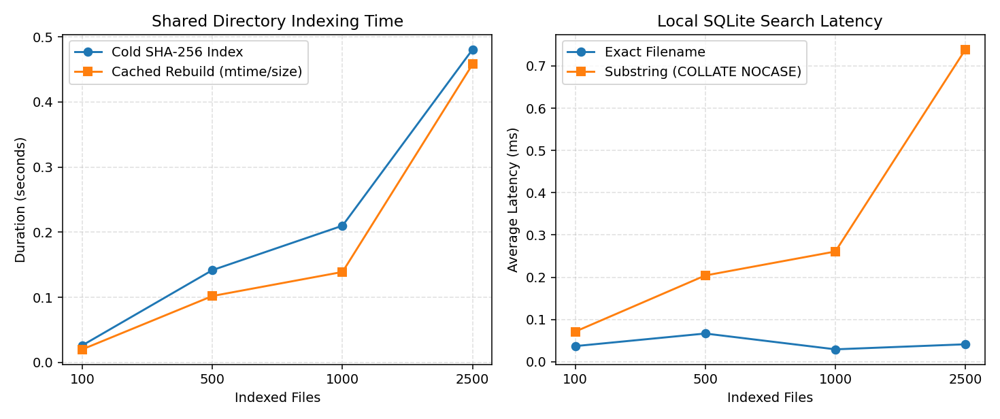

# Performance Benchmark Report

- **Python:** `3.12.6`
- **Platform:** `macOS-26.5-arm64-arm-64bit` (`arm64`, `8` CPUs)
- **Measured UTC:** `2026-11-25T05:10:56Z`

## 1. Transfer Throughput & Streaming Heap Allocation

| File Size | Chunk Size | Duration (s) | Throughput (MiB/s) | Throughput (Mbps) | Peak Heap (KiB) |
| --- | --- | --- | --- | --- | --- |
| 1,048,576 B | 16 KiB | 0.0593 | 16.87 | 141.5 | 463.2 |
| 1,048,576 B | 64 KiB | 0.0241 | 41.51 | 348.2 | 486.5 |
| 1,048,576 B | 128 KiB | 0.0201 | 49.73 | 417.2 | 1189.5 |
| 1,048,576 B | 256 KiB | 0.0166 | 60.09 | 504.1 | 1572.2 |
| 8,388,608 B | 16 KiB | 0.3817 | 20.96 | 175.8 | 744.4 |
| 8,388,608 B | 64 KiB | 0.1277 | 62.63 | 525.3 | 871.4 |
| 8,388,608 B | 128 KiB | 0.0883 | 90.58 | 759.9 | 1318.0 |
| 8,388,608 B | 256 KiB | 0.0639 | 125.10 | 1049.4 | 1829.5 |
| 33,554,432 B | 16 KiB | 1.6060 | 19.93 | 167.1 | 811.8 |
| 33,554,432 B | 64 KiB | 0.4560 | 70.18 | 588.7 | 873.4 |
| 33,554,432 B | 128 KiB | 0.2867 | 111.63 | 936.4 | 1320.0 |
| 33,554,432 B | 256 KiB | 0.2010 | 159.17 | 1335.2 | 2085.6 |

## 2. Concurrency Scaling (Loopback TCP)

| Concurrent Streams | Per-File Size | Wall Time (s) | Aggregate (MiB/s) | Aggregate (Mbps) |
| --- | --- | --- | --- | --- |
| 1 | 4,194,304 B | 0.0327 | 122.22 | 1025.2 |
| 2 | 4,194,304 B | 0.0552 | 145.02 | 1216.6 |
| 4 | 4,194,304 B | 0.1023 | 156.33 | 1311.4 |
| 8 | 4,194,304 B | 0.2194 | 145.86 | 1223.6 |

## 3. SQLite Indexing & Search Latency Scaling

| Files Indexed | Cold Index (s) | Cached Rebuild (s) | Exact Query (ms) | Substring Query (ms) |
| --- | --- | --- | --- | --- |
| 100 | 0.0262 | 0.0200 | 0.037 | 0.071 |
| 500 | 0.1417 | 0.1020 | 0.067 | 0.204 |
| 1000 | 0.2100 | 0.1389 | 0.029 | 0.261 |
| 2500 | 0.4807 | 0.4579 | 0.041 | 0.739 |

## 4. Resumable `.part` Recovery Comparison

| File Size | Resume Offset | Fresh Download (s) | Resumed Transfer (s) | Saved (s) |
| --- | --- | --- | --- | --- |
| 16,777,216 B | 8,388,608 B | 0.1370 | 0.0777 | 0.0594 |
