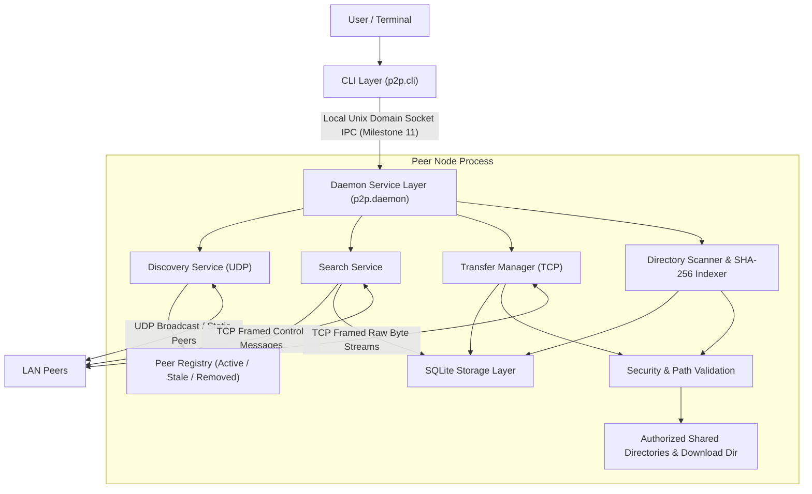

# System Architecture

**Project Title:** Design and Implementation of a Decentralized Peer-to-Peer File Discovery and Transfer System Using Python

## 1. Architectural Principles

1. **No Central Index or File Server:** Every participating node is symmetric — it acts as both a server (announcing availability, indexing its authorized directories, answering search queries, serving file streams) and a client (discovering peers, issuing searches, downloading and verifying files).
2. **Control Plane vs. Data Plane Separation:**
   - **Control Plane:** Small, bounded JSON messages (`DISCOVER`, `ANNOUNCE`, `HEARTBEAT`, `PING`, `PONG`, `SEARCH_REQUEST`, `SEARCH_RESPONSE`, `GET_FILE`, `FILE_INFO`, `TRANSFER_ERROR`) framed with a fixed 26-byte binary header.
   - **Data Plane:** Raw binary byte streaming via `FILE_DATA` frames bounded by configurable chunk size (`64 KiB` default, `256 KiB` ceiling), avoiding Base64/JSON bloat and keeping RAM usage constant regardless of file size.
3. **Single-Event-Loop Concurrency (`asyncio`) with Offloaded Blocking Work:**
   - UDP discovery and TCP socket I/O run asynchronously on Python's `asyncio` event loop.
   - CPU-bound SHA-256 hashing of large files and synchronous SQLite transactions are isolated from stalling network I/O (offloaded via `asyncio.to_thread()` with serialized DB access).
4. **Defense in Depth:**
   - Remote peers never supply filesystem paths; transfers address opaque internal `file_id` handles mapped through canonicalized, symlink-safe path containment checks.
   - All network inputs and payload lengths are validated before memory allocation.

## 2. Layered System Diagram

## 3. Module Responsibilities & Interaction Map

| Module / Package | Target Milestone | Responsibility |
| --- | --- | --- |
| `p2p.constants`, `p2p.exceptions` | Milestone 1 (Implemented) | Centralized protocol limits, default timeouts/ports, and domain exception hierarchy. |
| `p2p.utils` | Milestone 1 (Implemented) | UUIDv4 peer/request/transfer ID generation and validation; UTC and monotonic clocks. |
| `p2p.config` | Milestone 1 (Implemented) | Typed configuration dataclasses, `tomllib` parsing, validation, atomic TOML writes, shared-directory config management. |
| `p2p.logging_config` | Milestone 1 (Implemented) | UTC rotating file + stderr logging with `peer_id`, `request_id`, and `transfer_id` correlation fields. |
| `p2p.cli`, `p2p.main` | Milestone 1–6 & 8 (Implemented) | `argparse` CLI entry point (`python -m p2p`) supporting config, share, index rebuild, local search, direct download, downloads history, logs, and foreground `dev` peer node. |
| `p2p.network.framing`, `p2p.network.protocol`, `p2p.network.serialization` | Milestone 4 (Implemented) | Authoritative 26-byte binary header codec, typed schema validation for all 11 messages, JSON/raw serialization, and `RequestCorrelator`. |
| `p2p.network.tcp_server`, `p2p.network.tcp_client` | Milestone 2 & 4 (Implemented) | `asyncio.start_server` / `asyncio.open_connection` speaking 26-byte protocol frames with `request_id` correlation, bounded connections, and graceful shutdown. |
| `p2p.network.discovery`, `p2p.network.peer_registry` | Milestone 3 & 4 (Implemented) | UDP discovery (`DISCOVER`/`ANNOUNCE`/`HEARTBEAT`), static-peer TCP fallback, and `ACTIVE`/`STALE`/`REMOVED` peer registry using unified framing. |
| `p2p.storage` | Milestone 5 (Implemented) | SQLite schema migrations, serialized connection locking, and parameterized repositories (`peers`, `shared_files`, `downloads`, `transfer_checkpoints`). |
| `p2p.indexing` | Milestone 5 (Implemented) | Recursive non-symlink directory scanning, metadata caching `(size, mtime_ns)`, streaming SHA-256 hashing, and transfer-time revalidation. |
| `p2p.search.local_search` | Milestone 6 (Implemented) | Case-insensitive exact/partial SQLite search with escaped LIKE wildcards and `SEARCH_REQUEST` handler. |
| `p2p.search.distributed_search`, `p2p.search.result_merger` | Milestone 7 (Planned) | Bounded-timeout concurrent queries across active peers and cross-peer result deduplication. |
| `p2p.transfer` | Milestone 8 (Implemented; Resume in M9) | Explicit transfer state machine, bounded-chunk TCP upload/download streaming, `.part` temporary files, SHA-256 verification, and concurrent `TransferManager`. |
| `p2p.security.path_validation` | Milestone 5, 8 & 10 (Implemented; full hardening in M10) | Canonical symlink-safe path containment, `O_NOFOLLOW` descriptor checks, and download destination validation. |
| `p2p.daemon` | Milestone 11 (Planned) | Long-running service orchestrator, PID/lock management, Unix domain socket IPC server/client, graceful shutdown. |

## 4. Implementation Status

- **Completed:** Milestones 1–6 and Milestone 8 (foundation/CLI/config/logging, async TCP server/client, UDP discovery + peer registry, unified 26-byte binary framing, SQLite persistence, secure shared-directory SHA-256 indexing, local file search, direct TCP streaming upload/download, SHA-256 integrity verification, and download history).
- **Next:** Milestone 7 (distributed search across peers & result merging), Milestone 9 (resumable `.part` downloads), Milestone 10 (full security hardening), Milestone 11 (daemon & Unix socket IPC), Milestone 12 (benchmarks & final evaluation).
