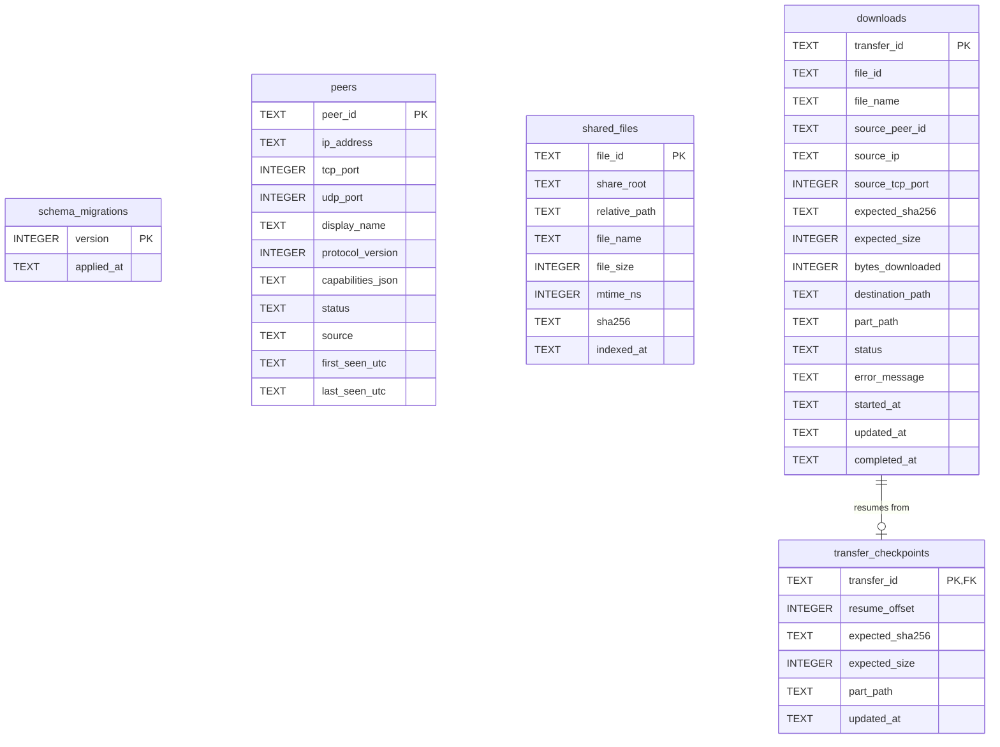

# SQLite Database Schema & Concurrency Model

This document describes the persistent SQLite schema introduced in **Milestone 5** and used across peer tracking, shared-file indexing, local search, and download/resume state management.

## 1. Connection & Concurrency Strategy

SQLite allows multiple readers concurrently under Write-Ahead Logging (`WAL`), while allowing only one writer at a time. Sharing an unguarded `sqlite3.Connection` across multiple `asyncio` coroutines or worker threads causes race conditions or `SQLITE_BUSY` errors.

[`Database`](file:///Users/madhurdandev/p2p/src/p2p/storage/database.py) uses a **serialized connection model**:
1. **Single Persistent Connection + `RLock`:** Opens `sqlite3.connect(..., check_same_thread=False, isolation_level=None)` protected by a re-entrant `threading.RLock`.
2. **WAL & Integrity Pragmas:** Enables `PRAGMA foreign_keys = ON`, `PRAGMA busy_timeout = 5000`, `PRAGMA journal_mode = WAL`, and `PRAGMA synchronous = NORMAL`.
3. **Explicit Transactions (`BEGIN IMMEDIATE` / `SAVEPOINT`):** `Database.transaction()` guarantees atomic multi-row updates (for example, upserting updated files and pruning deleted files together) with automatic `ROLLBACK` on error.
4. **Non-blocking Asyncio Offloading:** Coroutines call `await db.run(fn)` (`asyncio.to_thread`) so disk commits and full index rebuilds do not stall network I/O on the event loop.

---

## 2. Entity-Relationship Diagram

---

## 3. Tables & Indexes (Schema Version 1)

### `schema_migrations`
Tracks forward schema versions applied atomically on startup (`version INTEGER PRIMARY KEY`, `applied_at TEXT NOT NULL`).

### `peers`
Stores known discovered and static peers (`peer_id`, endpoint, `status` in `{'active', 'stale', 'removed'}`, `source` in `{'udp', 'static'}`, `first_seen_utc`, `last_seen_utc`).
- Index: `idx_peers_status_last_seen ON peers (status, last_seen_utc)`

### `shared_files`
Stores metadata and SHA-256 digests for authorized shared files (never raw file contents).
- Unique constraint: `UNIQUE (share_root, relative_path)`
- Indexes:
  - `idx_shared_files_name ON shared_files (file_name COLLATE NOCASE)` — accelerates case-insensitive local searches.
  - `idx_shared_files_sha256 ON shared_files (sha256)` — supports content-hash lookup/deduplication.
  - `idx_shared_files_root ON shared_files (share_root)` — accelerates per-root pruning.

### `downloads`
Tracks all queued, active, interrupted, failed, and completed downloads (`transfer_id`, `file_id`, `file_name`, source peer endpoint, `expected_sha256`, `expected_size`, `bytes_downloaded`, `destination_path`, `part_path`, `status`, `error_message`, timestamps).
- Indexes: `idx_downloads_status ON downloads (status)`, `idx_downloads_updated_at ON downloads (updated_at DESC)`.

### `transfer_checkpoints`
Stores resume metadata (`resume_offset`, `expected_sha256`, `expected_size`, `part_path`) for interrupted transfers, cascading delete when the parent `downloads` record is deleted.
