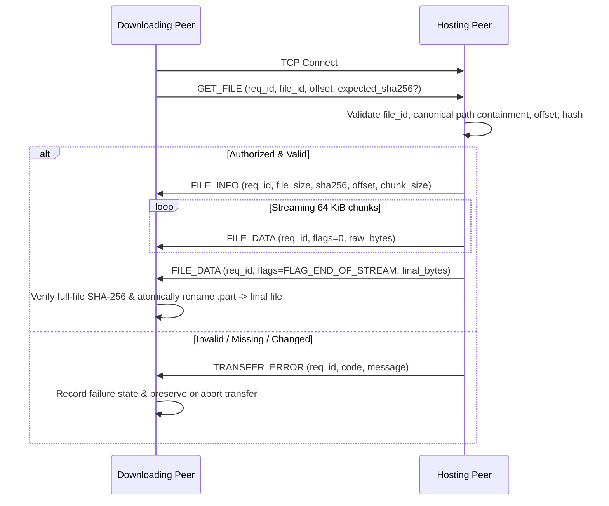

# Wire Protocol Specification (`P2P v1`)

This document is the authoritative specification for the application-layer wire protocol used over UDP (peer discovery) and TCP (search, health checks, and direct file transfers).

## 1. Design Goals

1. **Explicit Framing:** TCP is an unframed byte stream, not a message stream. A single `recv()`/`read()` call may return a partial message or multiple concatenated messages. Every message is therefore prefixed by a fixed-size binary header stating exact payload length.
2. **Safe Serialization:** Native Python serialization (`pickle`, `marshal`) is strictly forbidden. Control payloads use UTF-8 JSON dictionaries with strict schema validation; file contents travel as raw bytes in `FILE_DATA` frames.
3. **Request Correlation:** Every request embeds a 16-byte UUIDv4 `request_id` in the binary header so asynchronous responses are matched unambiguously and delayed/duplicate replies cannot corrupt unrelated requests.
4. **Bounded Memory:** Receivers validate the header magic, protocol version, message type, and `payload_len` **before** reading payload bytes into memory.

---

## 2. Binary Frame Format

All multi-byte integers use **network byte order (big-endian, `struct` prefix `!`)**.

### Fixed Header (`26 bytes`, `struct` format `!2sBBH16sI`)

| Offset | Size | Field | Type | Description |
| --- | --- | --- | --- | --- |
| `0` | 2 bytes | `magic` | `bytes` (`2s`) | Constant ASCII `b"P2"` (`0x50 0x32`). Rejects stray/non-protocol traffic immediately. |
| `2` | 1 byte | `version` | `uint8` (`B`) | Protocol version (`1`). Unknown versions are rejected. |
| `3` | 1 byte | `msg_type` | `uint8` (`B`) | Numeric message type identifier (`0x01`–`0x2F`). |
| `4` | 2 bytes | `flags` | `uint16` (`H`) | Bitfield flags (`0x0000` default; `0x0001` = `FLAG_END_OF_STREAM` for final `FILE_DATA` frame). |
| `6` | 16 bytes | `request_id` | `bytes` (`16s`) | Raw 128-bit UUIDv4 correlation ID (`uuid.uuid4().bytes`). |
| `22` | 4 bytes | `payload_len` | `uint32` (`I`) | Payload byte length (`0 <= payload_len <= max_allowed_for_msg_type`). |
| `26` | `payload_len` | `payload` | `bytes` | UTF-8 JSON (control messages) or raw file bytes (`FILE_DATA`). |

### Payload Size Limits & Timeouts

| Parameter | Default Value | Purpose |
| --- | --- | --- |
| `MAX_CONTROL_PAYLOAD_BYTES` | `65,536` (64 KiB) | Upper bound on all JSON control frames (`SEARCH_*`, `GET_FILE`, `FILE_INFO`, `TRANSFER_ERROR`, `PING`, `PONG`). |
| `MAX_DATA_CHUNK_BYTES` | `262,144` (256 KiB) | Maximum chunk size per `FILE_DATA` frame (default send chunk: `65,536` bytes). |
| `MAX_FRAME_PAYLOAD_BYTES` | `1,048,576` (1 MiB) | Absolute hard ceiling checked by the framing decoder. |
| `MAX_UDP_DATAGRAM_BYTES` | `1,200` bytes | Ceiling on UDP discovery datagrams to stay within standard 1500B Ethernet MTU and avoid IP fragmentation. |
| `connect_timeout_sec` | `5.0 s` | TCP `open_connection` timeout. |
| `control_timeout_sec` | `5.0 s` | Maximum wait for a control response frame on TCP. |
| `search_timeout_sec` | `3.0 s` | Maximum aggregate wait across all peers during distributed search. |
| `idle_timeout_sec` | `30.0 s` | Maximum inactivity gap while streaming `FILE_DATA` frames. |

---

## 3. Message Type Codes

| Code | Name | Transport | Plane |
| --- | --- | --- | --- |
| `0x01` | `DISCOVER` | UDP (Broadcast / Unicast) | Discovery |
| `0x02` | `ANNOUNCE` | UDP (Broadcast / Unicast) | Discovery |
| `0x03` | `HEARTBEAT` | UDP (Broadcast / Unicast) | Discovery |
| `0x10` | `PING` | TCP | Control |
| `0x11` | `PONG` | TCP | Control |
| `0x20` | `SEARCH_REQUEST` | TCP | Search |
| `0x21` | `SEARCH_RESPONSE` | TCP | Search |
| `0x30` | `GET_FILE` | TCP | Transfer |
| `0x31` | `FILE_INFO` | TCP | Transfer |
| `0x32` | `FILE_DATA` | TCP | Data |
| `0x3F` | `TRANSFER_ERROR` | TCP | Transfer |

---

## 4. Detailed Message Specifications

### 4.1 `DISCOVER` (`0x01`)
- **Purpose:** Solicit immediate `ANNOUNCE` replies from peers already online when a new peer starts.
- **Transport:** UDP (broadcast or configured static-peer unicast).
- **Required fields (JSON):**
  - `peer_id` (`str`, canonical 36-char UUID)
  - `tcp_port` (`int`, `1..65535`)
- **Optional fields:** `display_name` (`str`, max 64 chars), `capabilities` (`list[str]`, e.g., `["search_v1", "transfer_resume_v1"]`).
- **Validation rules:** Valid UUID `peer_id`; `1 <= tcp_port <= 65535`; total frame <= `MAX_UDP_DATAGRAM_BYTES`; ignore packets whose `peer_id` equals the local node's own `peer_id`.
- **Success response:** Receiving peer registers/updates the sender and unicasts an `ANNOUNCE` frame (preserving `request_id`) back to the sender's UDP source `(ip, udp_port)` or configured discovery port.
- **Error behavior:** Malformed UDP datagrams are logged at `WARNING`/`DEBUG` with source IP and dropped silently (never crashing the listener).
- **Timeout behavior:** Fire-and-forget; absence of responses means no reachable LAN peers replied within the discovery window.

### 4.2 `ANNOUNCE` (`0x02`)
- **Purpose:** Advertise a peer's presence, identity, and TCP endpoint (either unsolicited on startup or in reply to `DISCOVER`).
- **Transport:** UDP.
- **Required fields:** `peer_id` (`str`), `tcp_port` (`int`).
- **Optional fields:** `display_name` (`str`), `capabilities` (`list[str]`), `timestamp` (`str`, UTC ISO-8601).
- **Validation rules:** Same as `DISCOVER`. Source IP is taken from the actual UDP socket peer address (`addr[0]`), never blindly trusted from payload fields.
- **Success response:** No protocol reply required; receiver creates or refreshes peer record (`status = ACTIVE`, `last_seen = now`).
- **Error behavior:** Dropped and logged if malformed or self-originated.
- **Timeout behavior:** Handled via periodic `HEARTBEAT` and `stale_timeout_sec`.

### 4.3 `HEARTBEAT` (`0x03`)
- **Purpose:** Periodically refresh liveness so peers distinguish active nodes from stale/offline nodes.
- **Transport:** UDP.
- **Required fields:** `peer_id` (`str`), `tcp_port` (`int`).
- **Optional fields:** `display_name` (`str`), `shared_file_count` (`int >= 0`).
- **Validation rules:** Same peer/port checks as `ANNOUNCE`.
- **Success response:** Receiver updates `last_seen` and resets peer status to `ACTIVE`.
- **Error behavior:** Dropped and logged if invalid.
- **Timeout behavior:** If no `ANNOUNCE`/`HEARTBEAT` arrives for `stale_timeout_sec` (default `35.0 s`), peer transitions to `STALE`. After `remove_timeout_sec` (default `300.0 s`), peer is purged from active in-memory cache (retained in SQLite history if previously seen).

### 4.4 `PING` (`0x10`) and `PONG` (`0x11`)
- **Purpose:** Verify TCP reachability, protocol compatibility, and round-trip latency to a specific peer (including static fallback peers).
- **Transport:** TCP.
- **Required fields:**
  - `PING`: `peer_id` (`str`)
  - `PONG`: `peer_id` (`str`), `tcp_port` (`int`), `status` (`"ok"`)
- **Optional fields:** `display_name` (`str`), `sent_at_ms` (`int`).
- **Validation rules:** Valid UUID `peer_id`; payload <= `MAX_CONTROL_PAYLOAD_BYTES`.
- **Success response:** `PONG` echoing the exact `request_id` of the `PING`.
- **Error behavior:** Malformed frame triggers connection closure (`FramingError` / `MalformedMessageError` logged).
- **Timeout behavior:** Caller aborts wait after `control_timeout_sec` (`5.0 s`) and marks connectivity check failed.

### 4.5 `SEARCH_REQUEST` (`0x20`)
- **Purpose:** Query a remote peer's authorized local file index for matching filenames.
- **Transport:** TCP.
- **Required fields:**
  - `peer_id` (`str`, requester UUID)
  - `query` (`str`, `1 <= len(query.strip()) <= max_query_length`)
- **Optional fields:**
  - `max_results` (`int`, `1..MAX_SEARCH_RESULTS_PER_PEER`)
  - `exact` (`bool`, default `false`)
  - `hop_count` (`int`, default `0`, reserved for optional multi-hop extension)
  - `ttl` (`int`, default `1`, `1` = direct single-hop search)
- **Validation rules:** Non-empty trimmed query <= `256` chars; `max_results` clamped to `[1, 100]`; `ttl >= 1`.
- **Success response:** `SEARCH_RESPONSE` with matching `request_id`.
- **Error behavior:** Invalid requests receive a `TRANSFER_ERROR` (or protocol error closure) with `code = "INVALID_REQUEST"`.
- **Timeout behavior:** Querying peer cancels wait after `search_timeout_sec` (`3.0 s`) and proceeds with responses received from other peers.

### 4.6 `SEARCH_RESPONSE` (`0x21`)
- **Purpose:** Return matching file metadata from a peer's local SQLite index.
- **Transport:** TCP.
- **Required fields:**
  - `peer_id` (`str`, responder UUID)
  - `results` (`list[dict]`, max `100` entries). Each item contains:
    - `file_id` (`str`, opaque peer-local identifier — never an absolute filesystem path)
    - `file_name` (`str`)
    - `file_size` (`int >= 0`)
    - `sha256` (`str`, 64 lowercase hex characters)
    - `indexed_at` (`str`, UTC ISO-8601)
- **Optional fields:** `truncated` (`bool`, whether more matches existed beyond `max_results`).
- **Validation rules:** Verify `request_id` matches an outstanding search request; validate `file_size >= 0`, 64-hex `sha256`, and `len(file_name) <= max_filename_length` (sanitized basename on client display).
- **Success response:** Client merges results with hosting `(peer_id, ip, tcp_port)` metadata.
- **Error behavior:** Malformed response entries are rejected and logged; peer search fails cleanly for that peer without failing results from healthy peers.
- **Timeout behavior:** Ignored if received after the search request's correlation entry expired.

### 4.7 `GET_FILE` (`0x30`)
- **Purpose:** Request a direct TCP download (full or resumed from byte offset) of an authorized file identified by `file_id`.
- **Transport:** TCP.
- **Required fields:**
  - `peer_id` (`str`, requester UUID)
  - `file_id` (`str`, opaque file handle from `SEARCH_RESPONSE`)
  - `offset` (`int >= 0`, starting byte offset; `0` for new download)
- **Optional fields:**
  - `expected_sha256` (`str`, 64 hex chars — supplied on resume to detect source file changes)
  - `chunk_size` (`int`, requested chunk size clamped to `[1024, max_data_chunk_bytes]`)
- **Validation rules:**
  - `file_id` must resolve in the local index AND pass canonical symlink-safe path containment against configured shared directories.
  - `0 <= offset <= actual_file_size` (negative or out-of-range offsets are rejected).
  - If `expected_sha256` is provided on resume (`offset > 0`), it MUST match the current file's SHA-256 hash; otherwise reject with `FILE_CHANGED`.
- **Success response:** Server sends `FILE_INFO`, followed by zero or more `FILE_DATA` frames covering `[offset, file_size)` with the final `FILE_DATA` frame carrying `FLAG_END_OF_STREAM`.
- **Error behavior:** Server replies with `TRANSFER_ERROR` detailing the failure code and closes/ends that transfer cleanly.
- **Timeout behavior:** Client aborts if `FILE_INFO` is not received within `control_timeout_sec` (`5.0 s`).

### 4.8 `FILE_INFO` (`0x31`)
- **Purpose:** Confirm authorization and metadata for an accepted `GET_FILE` request right before streaming `FILE_DATA`.
- **Transport:** TCP.
- **Required fields:**
  - `file_id` (`str`)
  - `file_name` (`str`)
  - `file_size` (`int >= 0`, total file size in bytes)
  - `sha256` (`str`, 64 hex chars for the complete file)
  - `offset` (`int >= 0`, confirmed starting byte offset)
  - `chunk_size` (`int`, actual chunk size server will stream)
- **Optional fields:** none.
- **Validation rules:** `request_id` matches the outgoing `GET_FILE`; `0 <= offset <= file_size`; `file_size <= max_file_size_bytes` (if configured > 0); valid 64-hex `sha256`.
- **Success response:** Client transitions transfer state to `TRANSFERRING` and reads `FILE_DATA` frames.
- **Error behavior:** Invalid metadata aborts transfer before writing bytes.
- **Timeout behavior:** Client transitions to `TRANSFER_INTERRUPTED` if subsequent frames stall beyond `idle_timeout_sec`.

### 4.9 `FILE_DATA` (`0x32`)
- **Purpose:** Stream raw binary file bytes over TCP without JSON/Base64 encoding overhead.
- **Transport:** TCP (Data Plane).
- **Required fields:** Binary frame payload (`0 <= payload_len <= max_data_chunk_bytes`). Note: for 0-byte empty files or exact-offset EOF, a 0-byte `FILE_DATA` frame with `flags = FLAG_END_OF_STREAM` (`0x0001`) terminates the stream cleanly.
- **Validation rules:** `request_id` matches active transfer; `payload_len <= max_data_chunk_bytes`; cumulative received bytes `offset + received <= file_size`.
- **Success response:** Client streams bytes directly to `.part` file, updates progress, and upon receiving `FLAG_END_OF_STREAM` with exact expected byte count verifies SHA-256 across the complete file.
- **Error behavior:** Mid-stream socket EOF before `FLAG_END_OF_STREAM` or byte count mismatch marks transfer `TRANSFER_INTERRUPTED` while preserving `.part` for resume. Excess bytes beyond `file_size` abort as protocol error.
- **Timeout behavior:** Stalled frame read beyond `idle_timeout_sec` (`30.0 s`) closes socket and sets `TRANSFER_INTERRUPTED`.

### 4.10 `TRANSFER_ERROR` (`0x3F`)
- **Purpose:** Report structured, actionable transfer or request failures without crashing either peer.
- **Transport:** TCP.
- **Required fields:**
  - `code` (`str`, e.g., `FILE_NOT_FOUND`, `ACCESS_DENIED`, `INVALID_OFFSET`, `FILE_CHANGED`, `FILE_TOO_LARGE`, `BUSY`, `INVALID_REQUEST`)
  - `message` (`str`, human-readable non-sensitive error description)
- **Optional fields:** `retryable` (`bool`).
- **Validation rules:** Valid JSON control payload <= `MAX_CONTROL_PAYLOAD_BYTES`.
- **Success response:** Client maps `code` to explicit transfer failure state (e.g., `SOURCE_UNAVAILABLE` or `TRANSFER_INTERRUPTED`) and surfaces the message.
- **Error behavior:** If malformed, treated as `ProtocolError` and connection is closed.
- **Timeout behavior:** N/A.

---

## 5. Transfer Sequence Diagram

---

## 6. Request Correlation & Concurrency Safety

1. Each outbound request generates a fresh 128-bit `request_id = uuid.uuid4().bytes`.
2. In-flight requests on a multiplexed/request-response channel register `(request_id -> asyncio.Future)` bounded by `max_outstanding_requests`.
3. When a response arrives, the dispatcher checks `request_id`:
   - Matching pending future -> resolves it once.
   - Unknown or already-expired `request_id` -> logged and discarded (prevents delayed replies from poisoning subsequent operations).
4. Incoming frame reads enforce `readexactly(26)` for the fixed header, validate `magic == b"P2"`, `version == 1`, valid `msg_type`, and `payload_len <= type_limit` **before** calling `readexactly(payload_len)`.
